<p align="center">
  
</p>

<h1 align="center">InkPal</h1>

<p align="center">
  <b>A calm, black-and-white reader for Android.</b><br>
  Reads the EPUB and PDF books on your phone, plays your M4B audiobooks, remembers your place
  and keeps a quiet history of everything you read. No account, no ads, no internet.
</p>

<p align="center">
  <a href="https://github.com/SarveshP16/InkPal/releases/latest/download/InkPal.apk"></a>
  <a href="https://github.com/SarveshP16/InkPal/releases"></a>
</p>

<p align="center">
  <a href="https://github.com/SarveshP16/InkPal/releases/latest"></a>
  
  
  <a href="LICENSE"></a>
  <a href="https://ko-fi.com/crystaxit"></a>
</p>

<p align="center">
  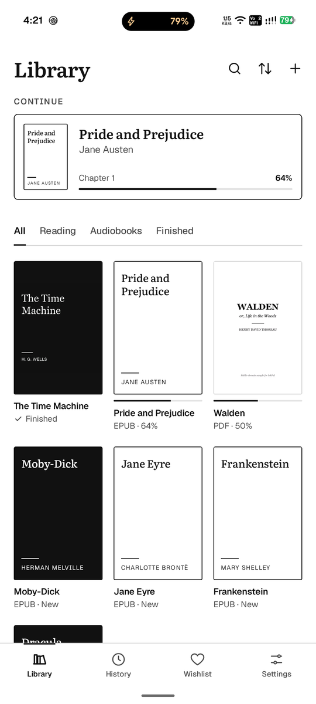
  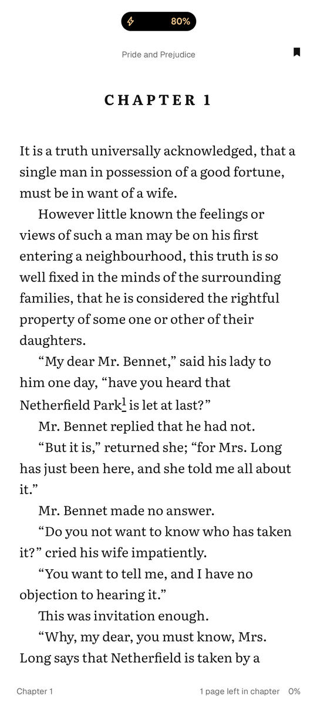
  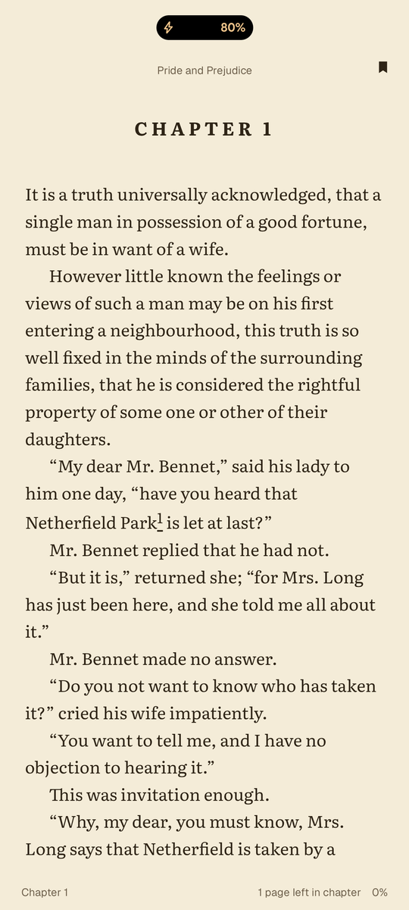
  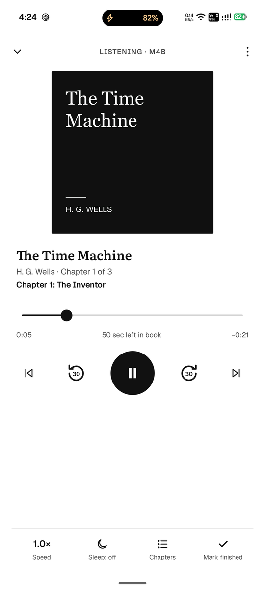
</p>

<p align="center"><sub>Screenshots use public-domain sample books.</sub></p>

## Contents

- [Features](#features)
- [Screenshots](#screenshots)
- [Download and install](#download-and-install)
- [How to use it](#how-to-use-it)
- [Privacy and battery](#privacy-and-battery)
- [Build from source](#build-from-source)
- [Support the project](#support-the-project)
- [Licence](#licence)

## Features

### Your library
- **Your own files.** Pick the folders on your phone that hold your books; InkPal finds every `.epub`, `.pdf` and `.m4b` inside them, subfolders too, and picks up new ones each time you open it.
- **Real covers, titles and authors** read from inside each file. Books without a cover get a clean typographic one.
- **Continue** cards for the book and the audiobook you're in the middle of, then **All / Reading / Audiobooks / Finished** shelves.
- **Search** by title or author, and **sort** by recently read, title or author.
- **Book details**: progress, size, page count or length, folder, reading sessions, reset progress, remove from library (the file stays on your phone).

### Reading EPUBs
- **Real pages**, not endless scrolling. Tap the right edge, swipe or press **volume down** to turn the page; tap the left edge or **volume up** to go back.
- **Tap the middle** for the menu: a slider to jump anywhere, previous / next chapter, contents, bookmarks and search.
- **Bookmarks** on any page, with the first words of the page so you know which is which. A small ribbon marks bookmarked pages.
- **Search inside the book**: every match with its context, grouped by chapter; tap one to jump there with the word highlighted.
- **Footnotes pop up** over the page instead of sending you to the back of the book. Links inside the book jump there with a **Back** chip to return; web links open in your browser.
- **Text settings**: size, font (**Literata**, sans, or the book's own), line spacing, margins and reader-only brightness. Changes apply instantly and keep your place.
- **White**, **Sepia** or **True black** theme. True black lights only the text, which saves power on OLED screens.

### Reading PDFs
- One page at a time, turned the same way as EPUBs: tap, swipe or volume keys.
- **Pinch or double-tap to zoom**, drag to look around; the page is re-drawn sharper when you zoom in.
- **Sepia** and **True black** recolour the page too.
- Bookmarks, a page slider, your place and reading sessions work as for EPUBs.

### Listening to audiobooks
- **M4B audiobooks** with their **chapters**, read from the file itself.
- Plays with the **screen off**, with controls in the notification and on the lock screen.
- **Skip 30 seconds** back or forward, previous / next chapter, a chapter list, and **speed** from 0.8× to 2×.
- **Sleep timer**: 15, 30, 45 or 60 minutes, or the end of the chapter.
- A **mini player** sits above the tabs while a book is playing.

### History, progress and wishlist
- **Your place is saved** on every page turn, and every few seconds while listening.
- **Reading and listening sessions** are logged automatically: when, for how long and how far.
- **History** shows time read this week, books finished this year, your streak, a day-by-day activity list and everything you've finished.
- **Mark as finished** from the book page, the reader menu, the player or the end-of-book screen, with undo.
- **Wishlist**: keep a list of books you want to read with the author and a note. Tick them off when you get them, and see when one is already in your library.

## Screenshots

| Library | Reader | Reader menu | Text settings |
|:---:|:---:|:---:|:---:|
|  |  | 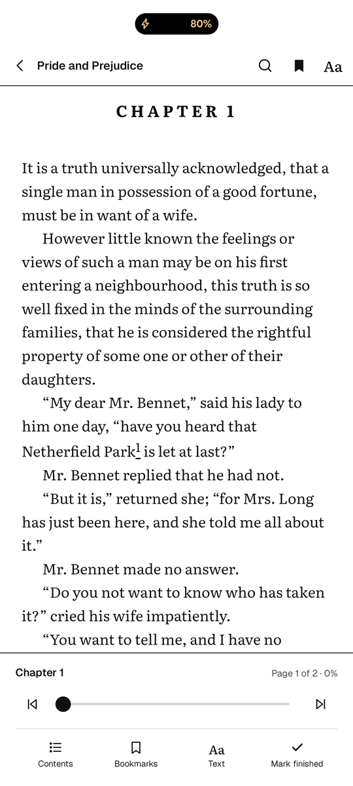 | 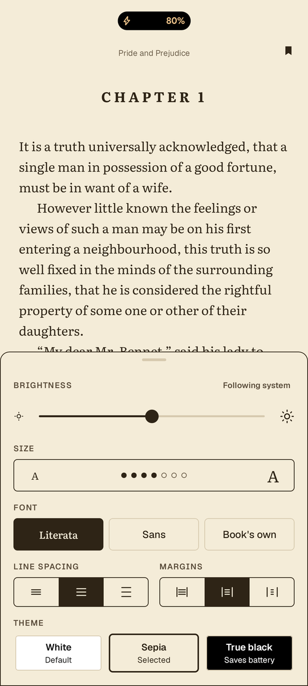 |

| Sepia | Search | Footnote | PDF |
|:---:|:---:|:---:|:---:|
|  | 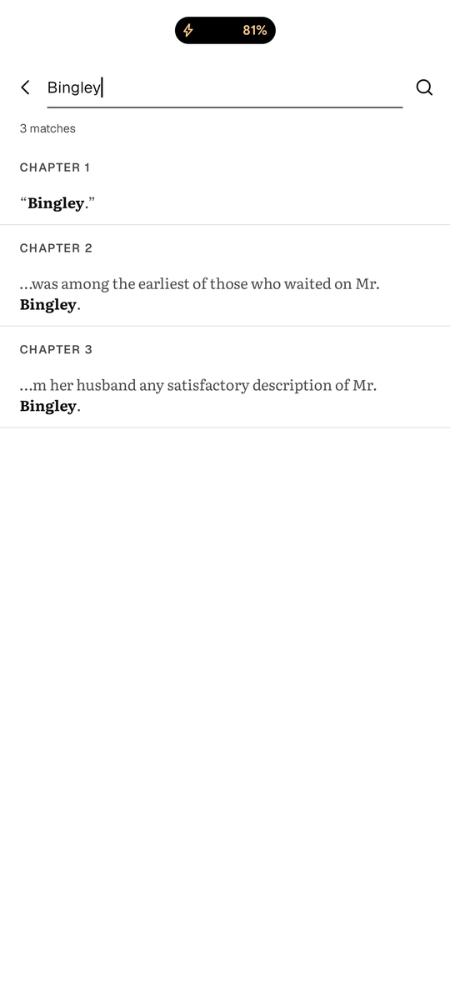 | 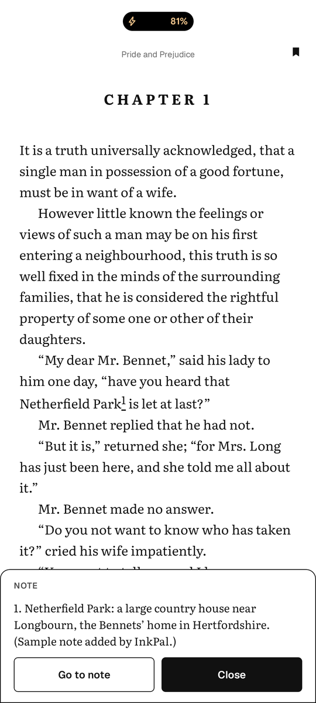 | 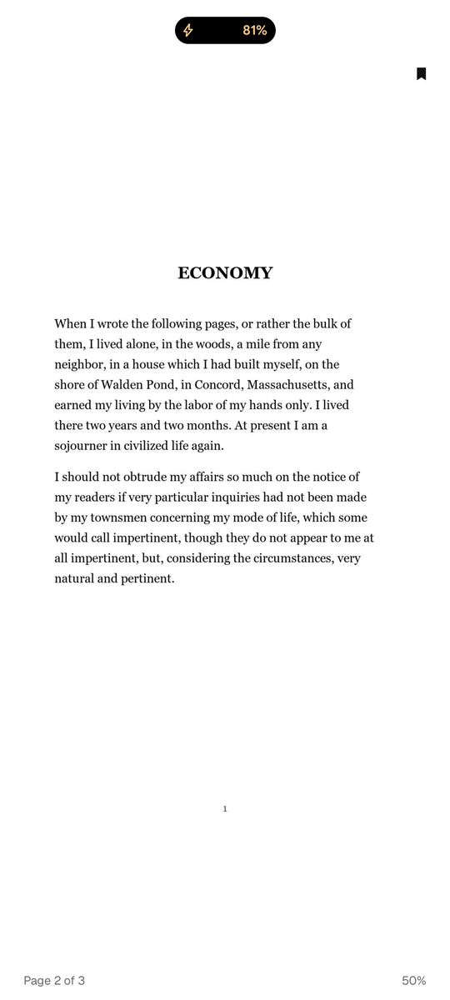 |

| Audiobook | Wishlist | History | Book details |
|:---:|:---:|:---:|:---:|
|  | 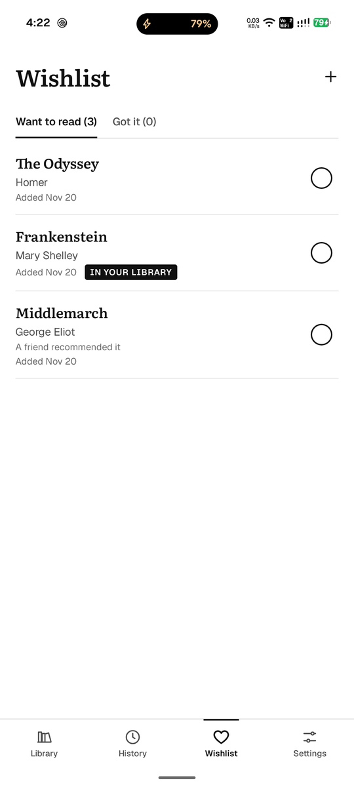 | 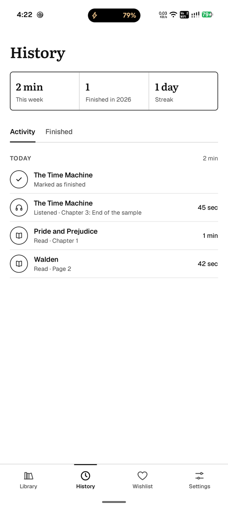 | 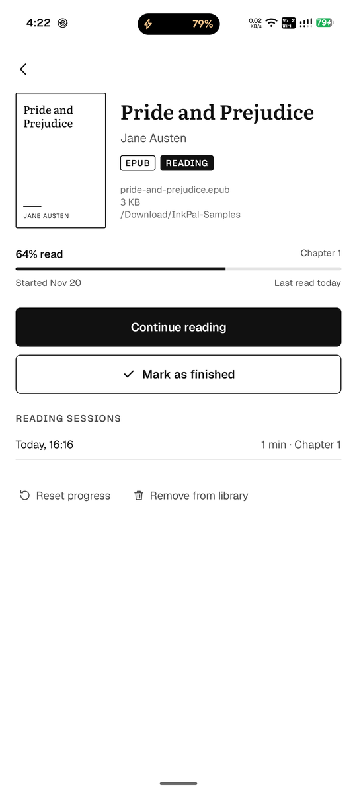 |

## Download and install

1. Download **[InkPal.apk](https://github.com/SarveshP16/InkPal/releases/latest/download/InkPal.apk)** from the [latest release](https://github.com/SarveshP16/InkPal/releases/latest).
2. Open it on your phone. If Android asks, allow your browser or file manager to install unknown apps.
3. Open InkPal and tap **Choose a folder**.

Requires Android 8.0 or newer. Every release is signed with the same key, so new versions install over the old one and keep your library.

## How to use it

| To… | Do this |
|---|---|
| Add books | **Choose a folder** on first launch, or **+** on the library, or **Settings → Add folder** |
| Turn the page | Tap the right edge, swipe left, or press volume down |
| Go back a page | Tap the left edge, swipe right, or press volume up |
| Open the menu | Tap the middle of the page |
| Bookmark a page | Menu → ribbon icon; see them in **Bookmarks** |
| Search the book | Menu → magnifier |
| Read a footnote | Tap its number |
| Change the text or theme | Menu → **Aa** |
| Zoom a PDF | Pinch, or double-tap |
| Listen | Open an `.m4b`; use the mini player above the tabs to get back to it |
| Finish a book | Read or listen to the end, or **Mark finished** |
| Remember a book for later | **Wishlist → +** |

## Privacy and battery

- **No permission prompts.** InkPal only sees the folders you pick, through Android's own folder picker. It has no internet access, no account, no analytics and no ads. The only permissions it declares are the three Android needs for audiobooks to keep playing with the screen off (foreground media service and wake lock); none of them asks you anything.
- **Everything stays on your phone**: your library, progress, bookmarks, wishlist and history are stored in the app's private storage.
- **Gentle on the battery.** Pages don't animate or redraw between turns, the screen can stay on while you read and turns off after a few idle minutes, and the true-black theme saves power on OLED screens.

## Build from source

You need JDK 21 and the Android SDK (platform 36).

```bash
git clone https://github.com/SarveshP16/InkPal.git
cd InkPal
./gradlew :app:assembleDebug
```

The APK is written to `app/build/outputs/apk/debug/`. The debug build installs alongside the release app as **InkPal (debug)**, with its own data.

To build a signed release, put a `keystore.properties` file in the project root (it is git-ignored):

```properties
storeFile=../your-release-key.jks
storePassword=…
keyAlias=…
keyPassword=…
```

then run `./gradlew :app:assembleRelease`.

**Stack:** Kotlin, Jetpack Compose and Material 3; a WebView-based paged EPUB engine with jsoup for contents and search; Android's PdfRenderer for PDFs; Media3 (ExoPlayer and MediaSession) for audiobooks; kotlinx.serialization for local storage.

## Support the project

InkPal is free and always will be. If it makes your reading a little nicer, you can buy me a coffee:

<a href="https://ko-fi.com/crystaxit"></a>

Bug reports and ideas are welcome in [Issues](https://github.com/SarveshP16/InkPal/issues).

## Licence

[MIT](LICENSE) © 2026 Sarvesh Pandit

The Literata typeface is © The Literata Project Authors and used under the [SIL Open Font License 1.1](licenses/Literata-OFL.txt).
