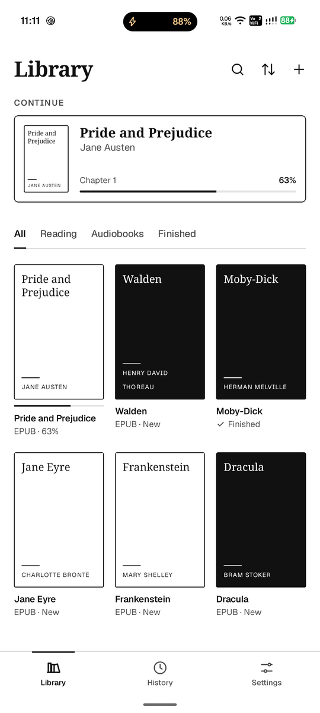
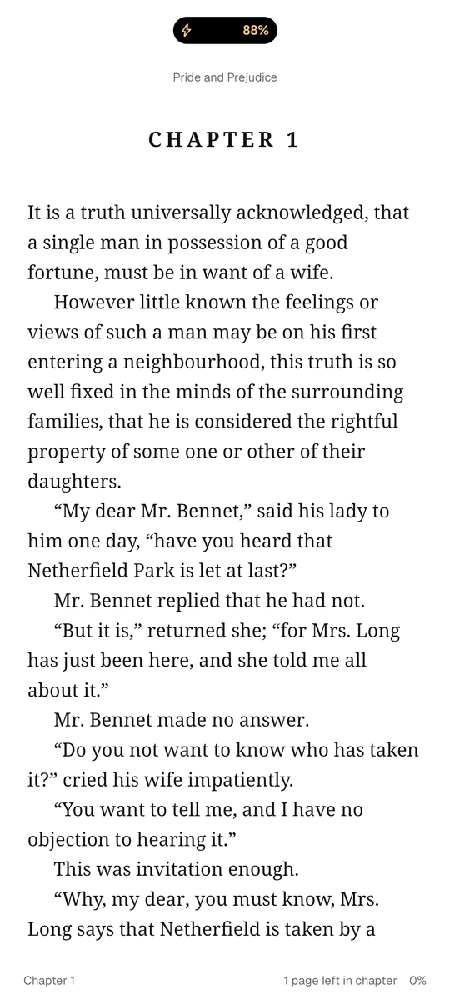
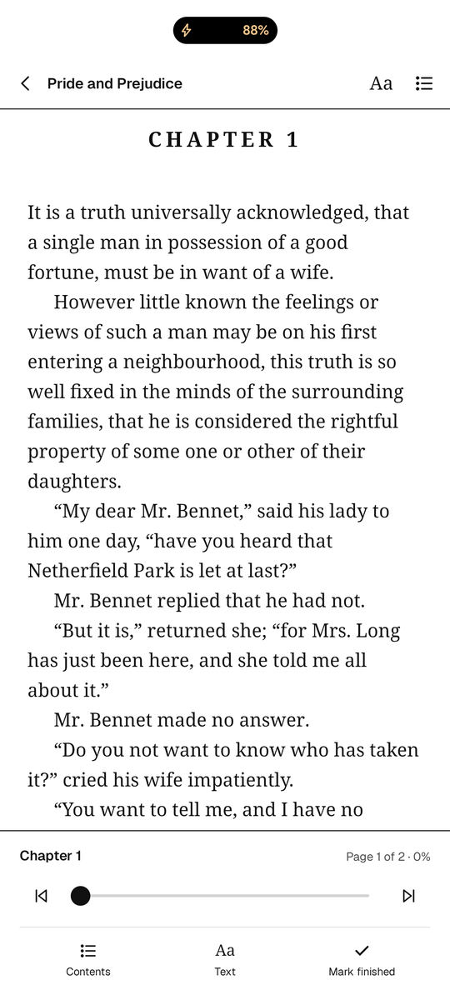
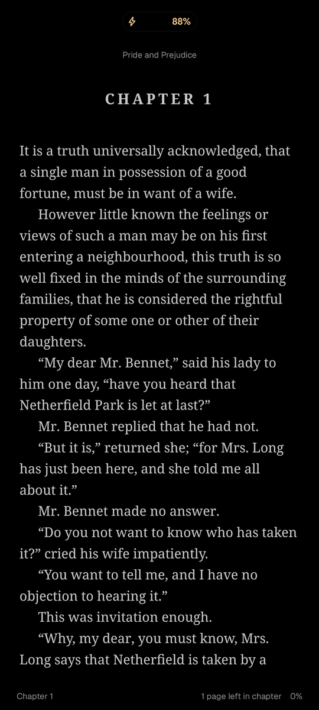
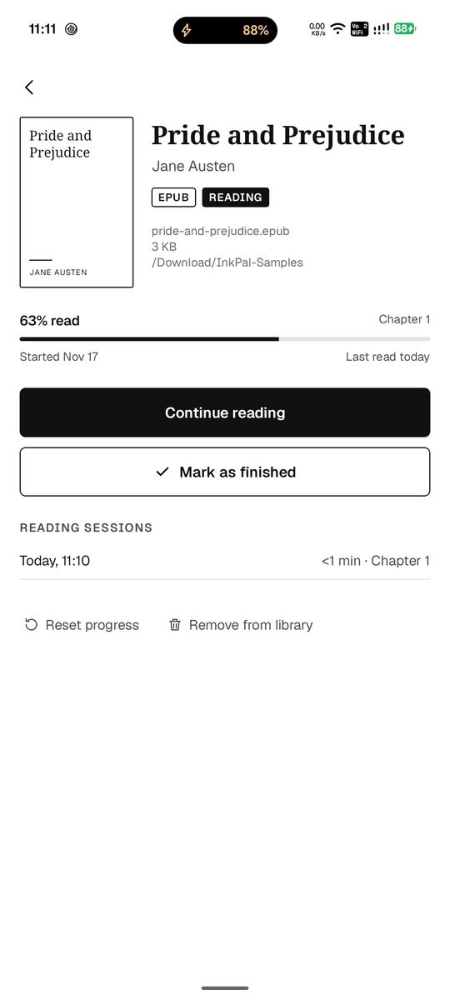
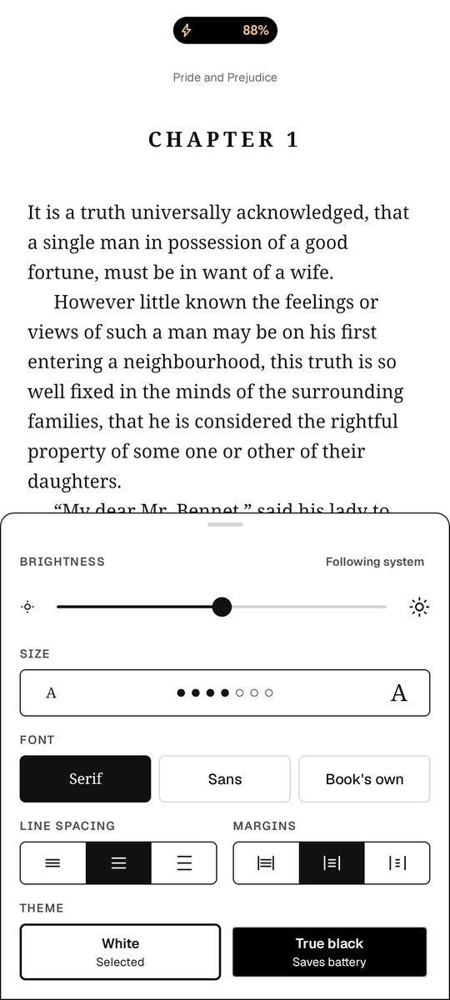
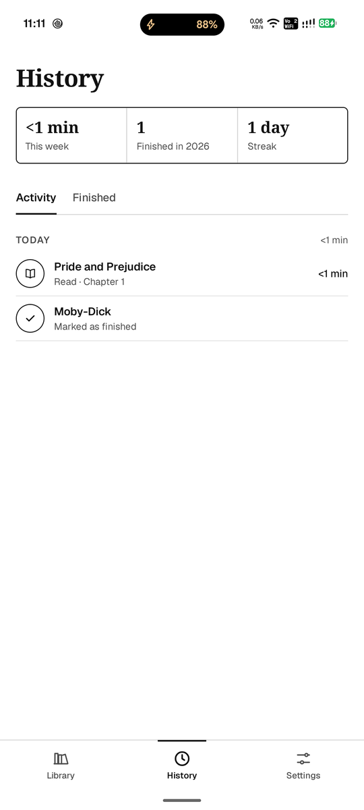
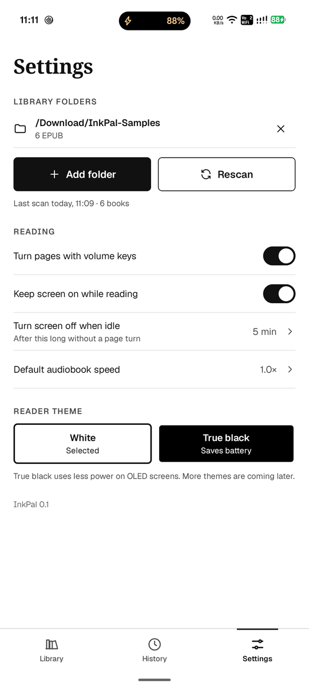

<p align="center">
  
</p>

<h1 align="center">InkPal</h1>

<p align="center">
  <b>A calm, black-and-white book reader for Android.</b><br>
  Reads the EPUB books already on your phone, remembers your page,
  and keeps a quiet history of everything you read. No account, no ads, no internet.
</p>

<p align="center">
  <a href="https://github.com/SarveshP16/InkPal/releases/latest/download/InkPal.apk"></a>
  <a href="https://github.com/SarveshP16/InkPal/releases"></a>
</p>

<p align="center">
  <a href="https://github.com/SarveshP16/InkPal/releases/latest"></a>
  
  
  <a href="LICENSE"></a>
  <a href="https://ko-fi.com/crystaxit"></a>
</p>

<p align="center">
  
  
  
  
</p>

<p align="center"><sub>Screenshots use public-domain sample books.</sub></p>

## Contents

- [Features](#features)
- [Screenshots](#screenshots)
- [Download and install](#download-and-install)
- [How to use it](#how-to-use-it)
- [Privacy and battery](#privacy-and-battery)
- [Build from source](#build-from-source)
- [Support the project](#support-the-project)
- [Licence](#licence)

## Features

### Your library
- **Your own files.** Pick the folders on your phone that hold your books; InkPal finds every `.epub` inside them, subfolders too, and picks up new ones each time you open it.
- **Real covers and titles** read from inside each book. Books without a cover get a clean typographic one.
- **Continue** card for the book you're in the middle of, then **All / Reading / Audiobooks / Finished** shelves.
- **Search** by title or author, and **sort** by recently read, title or author.
- **Book details**: progress, file size and folder, reading sessions, reset progress, remove from library (the file stays on your phone).

### The reader
- **Real pages**, not endless scrolling. Tap the right edge, swipe or press **volume down** to turn the page; tap the left edge or **volume up** to go back.
- **Tap the middle** for the menu: a slider to jump anywhere in the book, previous / next chapter and the chapter list.
- **Contents** from the book itself, with parts, nested chapters and your current chapter marked.
- **Text settings**: size, font (serif, sans or the book's own), line spacing, margins and reader-only brightness. Changes apply instantly and keep your place.
- **White** or **True black** theme. True black lights only the text, which saves power on OLED screens.
- A quiet header and footer: the book, the chapter, pages left in the chapter and your overall progress.

### History and progress
- **Your place is saved on every page turn**, in every book.
- **Reading sessions** are logged automatically: when you read, for how long and how far.
- **History** shows time read this week, books finished this year, your reading streak, a day-by-day activity list and everything you've finished.
- **Mark as finished** from the book page, the reader menu or the end-of-book screen, with undo.

### Audiobooks
- `.m4b` audiobooks are found and listed in the library with their cover, author and length. **Playback is coming in a future release.**

## Screenshots

| Library | Book details | Reader | Reader menu |
|:---:|:---:|:---:|:---:|
|  |  |  |  |

| Text settings | True black | History | Settings |
|:---:|:---:|:---:|:---:|
|  |  |  |  |

## Download and install

1. Download **[InkPal.apk](https://github.com/SarveshP16/InkPal/releases/latest/download/InkPal.apk)** from the [latest release](https://github.com/SarveshP16/InkPal/releases/latest).
2. Open it on your phone. If Android asks, allow your browser or file manager to install unknown apps.
3. Open InkPal and tap **Choose a folder**.

Requires Android 8.0 or newer. Every release is signed with the same key, so new versions install over the old one and keep your library.

## How to use it

| To… | Do this |
|---|---|
| Add books | **Choose a folder** on first launch, or **+** on the library, or **Settings → Add folder** |
| Turn the page | Tap the right edge, swipe left, or press volume down |
| Go back a page | Tap the left edge, swipe right, or press volume up |
| Open the menu | Tap the middle of the page |
| Change the text | Menu → **Aa** |
| Jump to a chapter | Menu → **Contents** |
| Finish a book | Read past the last page, or menu → **Mark finished** |
| Pick up new files | They're found automatically; or **Settings → Rescan** |

## Privacy and battery

- **No permissions.** InkPal only sees the folders you pick, through Android's own folder picker. It has no internet access, no account, no analytics and no ads.
- **Everything stays on your phone**: your library, progress and history are stored in the app's private storage.
- **Gentle on the battery.** Pages don't animate or redraw between turns, the screen can stay on while you read and turns off after a few idle minutes, and the true-black theme saves power on OLED screens.

## Build from source

You need JDK 21 and the Android SDK (platform 36).

```bash
git clone https://github.com/SarveshP16/InkPal.git
cd InkPal
./gradlew :app:assembleDebug
```

The APK is written to `app/build/outputs/apk/debug/`.

To build a signed release, put a `keystore.properties` file in the project root (it is git-ignored):

```properties
storeFile=../your-release-key.jks
storePassword=…
keyAlias=…
keyPassword=…
```

then run `./gradlew :app:assembleRelease`.

**Stack:** Kotlin, Jetpack Compose and Material 3, a WebView-based paged EPUB engine, jsoup for book contents, and kotlinx.serialization for local storage.

## Support the project

InkPal is free and always will be. If it makes your reading a little nicer, you can buy me a coffee:

<a href="https://ko-fi.com/crystaxit"></a>

Bug reports and ideas are welcome in [Issues](https://github.com/SarveshP16/InkPal/issues).

## Licence

[MIT](LICENSE) © 2026 Sarvesh Pandit
